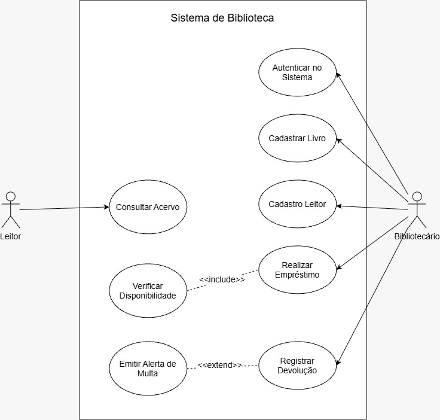
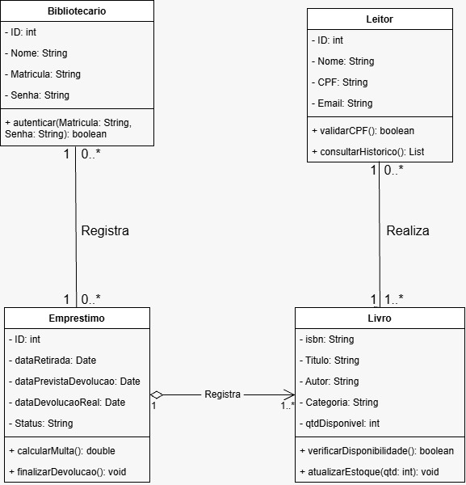

# Sistema de Gestão de Biblioteca (Biblioteca Central)

**Relatório Técnico do Sistema — Trabalho Prático de APS**  
Documentação do projeto prático envolvendo os requisitos, regras operacionais, diagramas, interface e arquitetura da aplicação desenvolvida.

| Campo | Detalhe |
| :--- | :--- |
| **Disciplina** | Análise e Projeto de Sistemas (APS) |
| **Aluno** | Pedro Emanuel Cócio Prado |
| **Entrega** | Documentação Técnica e Projeto |
| **Abordagem** | Desenvolvimento Web Modular (HTML / CSS / JS) |
| **Armazenamento** | Local Storage e Session Storage |

---

## 1. Apresentação e Contexto do Projeto

Este documento consolida o trabalho desenvolvido na disciplina de Análise e Projeto de Sistemas. O projeto consiste em uma aplicação web voltada para resolver problemas comuns de controle em bibliotecas acadêmicas ou comunitárias, como a perda de controle sobre quais livros estão emprestados, o esquecimento de prazos de devolução e a falta de histórico dos usuários.

Para estruturar o sistema de forma limpa e sem depender de servidores complexos na fase inicial de testes, optamos por uma arquitetura *client-side* utilizando HTML5, CSS moderno e JavaScript puro. A lógica foi dividida em três arquivos principais (`index.html`, `style.css` e `script.js`), garantindo que o código fique fácil de manter e que os dados fiquem salvos direto no navegador do usuário.

* **Controle de Acesso:** Dividimos a aplicação em dois perfis básicos para evitar uso indevido. O leitor comum consegue apenas consultar o acervo livremente, enquanto as operações de cadastro, empréstimo e baixa exigem a senha de bibliotecário.

### 1.1. O que o sistema resolve na prática
* **Controle de Estoque:** Evita que o sistema permita emprestar um livro que não possui mais exemplares disponíveis na estante.
* **Validação de Usuários:** Garante que cada leitor seja cadastrado com um CPF verdadeiro de 11 dígitos, evitando CPFs duplicados ou inventados.
* **Cálculo de Multas:** Automatiza a cobrança de taxa por dias de atraso na devolução dos livros, ajudando a manter a rotatividade do acervo.

---

## 2. Regras de Negócio Implementadas

Durante a fase de levantamento, definimos as regras que o sistema é obrigado a seguir para funcionar corretamente no dia a dia:

| ID | Regra | Como funciona na prática do sistema |
| :--- | :--- | :--- |
| **RN01** | Cadastro Único por CPF | O sistema valida se o CPF digitado tem exatamente 11 números e impede que duas contas sejam criadas com o mesmo documento. |
| **RN02** | Agrupamento por ISBN | Se o bibliotecário tentar cadastrar um livro com um ISBN que já existe, o sistema apenas soma os novos exemplares ao estoque em vez de criar uma linha repetida. |
| **RN03** | Limite de Exemplares | O empréstimo só é liberado se houver pelo menos 1 exemplar disponível. Livros zerados ficam marcados como indisponíveis. |
| **RN04** | Prazos e Renovação | Cada empréstimo vale por 7 dias. O bibliotecário pode estender esse prazo por mais 7 dias caso o leitor precise de mais tempo. |
| **RN05** | Multa por Atraso | Se o livro for devolvido depois da data limite, o sistema cobra uma taxa fixa de **R$ 2,50** por cada dia de atraso. |
| **RN06** | Proteção contra Exclusão | Não é permitido apagar um livro ou um leitor que esteja com um empréstimo ativo no momento. |

---

## 3. Requisitos e Rastreabilidade

Separamos o que o software precisa fazer (requisitos funcionais) das características técnicas (requisitos não funcionais).

### 3.1. Requisitos Funcionais

| ID | Nome | O que faz | Quem usa |
| :--- | :--- | :--- | :--- |
| **RF01** | Pesquisar Livros | Permite achar obras digitando o nome, autor ou ISBN, filtrando também por livros disponíveis. | Leitor / Bibliotecário |
| **RF02** | Login do Gestor | Tela de acesso restrito para liberar as ferramentas de cadastro e controle. | Bibliotecário |
| **RF03** | Gerenciar Livros | Adicionar novos títulos ou atualizar o estoque dos livros já cadastrados. | Bibliotecário |
| **RF04** | Cadastrar Leitores | Salvar dados dos usuários com verificação de CPF. | Bibliotecário |
| **RF05** | Histórico do Leitor | Mostrar a lista de todos os livros que aquele usuário já pegou emprestado. | Bibliotecário |
| **RF06** | Realizar Empréstimo | Vincular um livro a um leitor e dar baixa de 1 unidade no estoque. | Bibliotecário |
| **RF07** | Renovar Prazo | Estender a data de devolução em mais 7 dias. | Bibliotecário |
| **RF08** | Devolução e Multa | Marcar o livro como devolvido, somar o exemplar de volta à estante e calcular multa se houver atraso. | Bibliotecário |

### 3.2. Requisitos Não Funcionais

| ID | Categoria | Detalhe técnico |
| :--- | :--- | :--- |
| **RNF01** | Desempenho | Buscas e filtros devem rodar instantaneamente na tela sem travamentos. |
| **RNF02** | Armazenamento | Uso do `localStorage` do navegador para que os dados não sumam ao fechar a aba. |
| **RNF03** | Organização | Código limpo e versionado no Git com histórico de commits organizado. |
| **RNF04** | Responsividade | A interface deve funcionar em celular, tablet e computador, reorganizando o conteúdo conforme o tamanho da tela. |
| **RNF05** | Usabilidade | Textos com alto contraste, foco visível nos campos e dados numéricos (ISBN, CPF e datas) em fonte monoespaçada. |

---

## 4. Modelagem de Casos de Uso

Abaixo está o diagrama desenvolvido para mapear as interações dos atores com o sistema, seguido da explicação detalhada dos fluxos principais.

### 4.1. Descrição dos Casos de Uso Principais

#### Caso de Uso: Realizar Empréstimo
* **Ator:** Bibliotecário
* **Resumo:** O operador seleciona um leitor e um livro disponível para registrar a saída da obra.
* **Passos:**
  1. O bibliotecário abre a aba de empréstimos.
  2. Escolhe o leitor na lista.
  3. Escolhe o livro (o sistema valida se há exemplares com `<<include>>`).
  4. Define a data limite e confirma a operação. O estoque é reduzido automaticamente.

#### Caso de Uso: Registrar Devolução
* **Ator:** Bibliotecário
* **Resumo:** Baixa do livro emprestado e cálculo de eventuais multas.
* **Passos:**
  1. O operador localiza o empréstimo ativo na tabela.
  2. Clica em devolver. Se houver atraso, o sistema calcula a multa (`<<extend>>`).
  3. O livro retorna para o estoque disponível.

---

## 5. Modelagem de Classes

O diagrama de classes estruturou a modelagem dos objetos da aplicação e suas cardinalidades.

### 5.1. Dicionário das Classes

| Classe | Atributos principais | Métodos principais |
| :--- | :--- | :--- |
| **Bibliotecario** | `ID`, `Nome`, `Matricula`, `Senha` | `autenticar(Matricula, Senha)` |
| **Leitor** | `ID`, `Nome`, `CPF`, `Email` | `validarCPF()`, `consultarHistorico()` |
| **Livro** | `isbn`, `Titulo`, `Autor`, `Categoria`, `qtdDisponivel` | `verificarDisponibilidade()`, `atualizarEstoque(qtd)` |
| **Emprestimo** | `ID`, `dataRetirada`, `dataPrevistaDevolucao`, `dataDevolucaoReal`, `Status` | `calcularMulta()`, `finalizarDevolucao()` |

---

## 6. Interface e Identidade Visual

Como o sistema também é usado pelos leitores para consultar o acervo, a interface foi pensada para fugir da aparência de "sistema corporativo" e transmitir a sensação de uma livraria ou biblioteca contemporânea, culta e convidativa. Por isso, adotamos um modo escuro editorial com detalhes em tons quentes, que lembram a lombada de livros clássicos iluminados por luz amarela.

A parte visual fica concentrada nos arquivos `index.html` e `style.css`, enquanto toda a lógica permanece no `script.js`. A ligação entre as duas camadas é feita por IDs e classes fixos (como `#tabelaAcervo`, `#buscaLivro`, `#formLivro` e `.admin-only`), o que permite ajustar o visual sem interferir nas regras de negócio.

* **Perfis na Interface:** A classe `.admin-only` marca tudo o que é exclusivo do bibliotecário, como as abas de cadastro e a coluna de ações do acervo. No modo leitor, esses elementos ficam ocultos, deixando a tela limpa e focada apenas na consulta.

### 6.1. Elementos da Interface
* **Página de Abertura:** O topo apresenta um título editorial e uma estante de livros desenhada apenas com CSS, sem imagens e sem ícones.
* **Cards de Acervo:** Os indicadores de títulos, exemplares, leitores e empréstimos imitam fichas físicas, com uma faixa lateral colorida no lugar da lombada e uma fita de marca-página no canto.
* **Leitura dos Dados:** ISBN, CPF, datas, IDs e multas aparecem em fonte monoespaçada, facilitando a conferência dos números pelo bibliotecário.
* **Uso no Celular:** O layout segue a abordagem *mobile-first*, começando em uma coluna no celular e se expandindo para duas, três ou quatro colunas em telas maiores.

---

## 7. Repositório do Projeto

Todo o código-fonte da aplicação, junto com os diagramas e o histórico de commits do desenvolvimento, está disponível no repositório Git abaixo:

* **Repositório Git:** https://github.com/Predonamuel/sistema-biblioteca.git